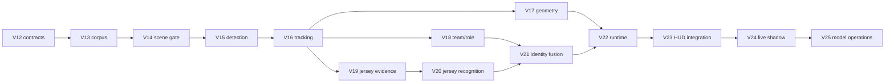

# Granular real-time vision roadmap

The vision system is a second engineering program built on top of the fantasy
platform. It is intentionally divided into small versions so model accuracy,
temporal behavior, latency, and product safety can be diagnosed independently.

## Dependency map

## Phases

| Phase | Versions | Question answered | Exit evidence |
|---|---|---|---|
| Foundations | V12–V13 | Can experiments be trusted and reproduced? | Contracts, manifests, permitted data, validated splits |
| Perception | V14–V17 | Can players be found, followed, and located stably? | Scene, detection, tracking, and geometry reports |
| Identity evidence | V18–V21 | Can a track be mapped safely to a player? | Calibrated team/jersey evidence and precision–coverage gate |
| Real-time product | V22–V23 | Can the pipeline remain current and render correctly? | Full-game soak, broker replay, synchronized authenticated HUD |
| Live operations | V24–V25 | Can it be validated and operated without unsafe releases? | Shadow reviews, drift monitors, canary and rollback drills |

## Python-first delivery progression

The first useful vision system does not require a desktop framework. Build and
measure the perception loop in Python, connect it to the browser only after
deterministic replay works, and introduce Tauri only when packaging, native
integration, reliability, or a measured hot path justifies it.

| Step | Versions | Build | Stop with | Do not add yet |
|---|---|---|---|---|
| 0. Capture-only prework | Now, alongside V10–V11 | Record a small private raw-video library and a minimal provenance sidecar for each file. Do not annotate or choose train/test membership yet. | Immutable raw files outside Git, checksums, source/game/session IDs, resolution, frame rate, capture method, and notes. | Model training, random frame splits, Tauri |
| 1. Contracts | V12 | Framework-neutral frame, detection, track, identity, marker, timestamp, and experiment-manifest contracts. | Synthetic records pass every contract and malformed records fail. | Real model coupling |
| 2. Corpus and replay harness | V13 | Curate short clips from recorded and research datasets, annotate with CVAT or equivalent, split by game, and read them through an OpenCV CLI. | Versioned manifest, annotation guide, validator, train/validation/test games, deterministic replay command. | Live capture and user-visible labels |
| 3. Pure Python perception | V14–V16 | Scene/cut gate, player/official detector, and online tracker in Python/OpenCV/PyTorch. | Rendered diagnostic videos plus sliced scene, detection, tracking, latency, and failure reports. | Browser transport, Rust rewrite |
| 4. Geometry and identity evidence | V17–V21 | Coordinate transforms, team/role classification, jersey crops and temporal recognition, calibrated identity fusion, and abstention. | Held-out-game evidence showing where markers belong and when identity must remain unknown. | Product claims from roster membership alone |
| 5. Bounded Python runtime | V22 | A local Python worker with bounded queues, newest-frame policy, stage timestamps, and a full-game soak. Compare PyTorch and ONNX only after profiling. | No unbounded queue growth; capture-to-output and resource gates pass for a complete game replay. | Tauri based only on assumed speed |
| 6. Browser replay and live bridge | V23–V24 | First replay marker records through the real broker/HUD. Then add user-started Chrome tab capture, resize/sample frames, send binary frames to the local Python worker, and shadow-run live. | Deterministic replay survives reconnect/resize; permitted live sessions produce reviewed shadow evidence. | Automatic user-visible identity labels |
| 7. Desktop product gate | After V22 measurements, no later than V24 planning | Decide whether a Tauri shell is justified for one-click startup, process supervision, installers, native capture, system tray, updates, or a proven Rust-suitable hot path. | A short ADR with measured reasons to adopt or defer Tauri. | Rewriting working ML code merely to change languages |
| 8. Operate and optimize | V25 | Package only the proven topology, add model lineage, drift, canary, rollback, and hard-example loops. Migrate isolated hot paths to Rust only with before/after evidence. | Controlled promotion and rollback with the text HUD preserved during vision failure. | Unmeasured optimization |

### Tauri decision rule

Adopt Tauri when at least one of these is demonstrated:

- a normal user needs one-click install/start/stop rather than a terminal;
- the Python worker needs supervised restart, model management, or native OS UI;
- browser capture cannot satisfy an approved capture requirement and a native
  path is both permitted and technically viable;
- an always-on-top overlay outside the browser is a product requirement; or
- profiling identifies a bounded queue, decode, transport, or inference path
  that a Rust implementation can improve without reducing model quality.

Until then, the live prototype remains a Chrome capture/overlay adapter plus a
local Python vision service. "Rust is faster" by itself is not an adoption gate.

## Video acquisition strategy

Recording the target broadcast now is useful and should be the primary source
of domain-matched evaluation footage, assuming the stated permission. Recording
is acquisition, however—not yet training data. A file becomes trustworthy model
data only after it has provenance, labels, a game-level split, and validation.

### Record-now protocol

1. Keep raw recordings outside Git in an immutable `raw/` store.
2. Create a sidecar manifest with source/game/session ID, capture timestamp,
   resolution, frame rate, capture method, checksum, and permission/provenance
   note.
3. Record full variation: wide and close shots, replays, commercials, scorebugs,
   night/day games, uniform combinations, weather, motion blur, pile-ups, and
   fullscreen/theater layouts.
4. Extract short clips around useful scenes; do not label hundreds of nearly
   identical adjacent frames.
5. Split by game or recording session before annotation. Never scatter frames
   from the same play across train and test.
6. Keep one or more games sealed as the untouched test set.
7. Annotate `unknown`, occlusion, camera cut, shot type, team/role, and jersey
   visibility as first-class states.

### Candidate source ladder

| Source | Best use | Important limitation |
|---|---|---|
| Self-recorded permitted Sunday Ticket/broadcast sessions | Primary domain corpus for broadcast shots, overlays, uniforms, blur, camera cuts, tracking, and end-to-end evaluation | Requires your own annotation; capture may be technically restricted; one season or team is not enough diversity |
| [NFL Helmet Assignment](https://www.kaggle.com/competitions/nfl-health-and-safety-helmet-assignment) | NFL helmet detection, tracking, player assignment, optical-flow and geometry experiments | Sideline/end-zone safety footage differs from consumer broadcast footage; follow the competition's access terms |
| [NFL Impact Detection](https://www.kaggle.com/c/nfl-impact-detection/data) | Paired sideline/end-zone video, helmet boxes, aligned views, collision and occlusion hard cases | Biased toward impacts and helmets rather than full-body broadcast identity |
| [NFL Player Contact Detection](https://www.kaggle.com/competitions/nfl-player-contact-detection) | NFL video plus tracking-data fusion and temporal modeling examples | The target is contact, not HUD identity; competition access rules still apply |
| [NFL Big Data Bowl](https://operations.nfl.com/programs-initiatives/innovation/big-data-bowl) | Field-coordinate priors, motion plausibility, formation context, and geometry experiments | Primarily tracking/tabular data, not a replacement for video labels |
| [SportsMOT](https://github.com/MCG-NJU/SportsMOT) | Multi-object tracking pretraining, TrackEval practice, HOTA/IDF1 baselines, crowded sports motion | Its football category is association football, not NFL; use for transfer and tooling rather than final validation |
| [SoccerNet tracking, re-identification, calibration, and jersey datasets](https://github.com/SoccerNet/SoccerNet) | Tracking, camera calibration, re-identification, jersey-crop/temporal-recognition workflow, and annotation practice | Strong domain gap in uniforms, camera grammar, field geometry, and player density; some assets are gated |
| [CVAT](https://docs.cvat.ai/) | Frame/video boxes, tracks, attributes, interpolation, and annotation review | Annotation software, not footage; define the handbook and quality checks first |

Public sports data should bootstrap tools and representations. Final detector,
tracker, calibration, and identity decisions must be evaluated on held-out clips
from the actual target broadcast distribution.

## Version index

| Version | Primary deliverable | Decision unlocked |
|---|---|---|
| [V12](../curriculum/versions/V12.md) | Vision contracts and safety gates | What every stage must prove |
| [V13](../curriculum/versions/V13.md) | Authorized evaluation corpus | Whether comparisons are valid |
| [V14](../curriculum/versions/V14.md) | Shot and camera-cut gate | When temporal state may continue |
| [V15](../curriculum/versions/V15.md) | Player/official detector | Which detector meets application needs |
| [V16](../curriculum/versions/V16.md) | Online tracker | Which association strategy is trustworthy |
| [V17](../curriculum/versions/V17.md) | Geometry and coordinates | Where a marker belongs on screen |
| [V18](../curriculum/versions/V18.md) | Team and role evidence | Which candidate identities remain plausible |
| [V19](../curriculum/versions/V19.md) | Jersey visibility and crops | Whether number evidence should be attempted |
| [V20](../curriculum/versions/V20.md) | Temporal number distribution | What jersey numbers the track supports |
| [V21](../curriculum/versions/V21.md) | Calibrated identity resolver | Whether an identity is safe to display |
| [V22](../curriculum/versions/V22.md) | Bounded real-time graph | Whether the system stays current for a game |
| [V23](../curriculum/versions/V23.md) | Replay-to-HUD integration | Whether production transport/rendering is correct |
| [V24](../curriculum/versions/V24.md) | Permitted live shadow evidence | Whether offline results survive live conditions |
| [V25](../curriculum/versions/V25.md) | Model operations and release controls | Whether vision can be promoted and rolled back safely |

## Rules for advancing

1. Pass the current version's hard gates before starting its successor.
2. Keep an unchanged baseline; change one major component per comparison.
3. Tune on validation data and open the test set only for a frozen decision.
4. Report overall metrics and difficult scenario slices.
5. Preserve timestamps and intermediate records for deterministic replay.
6. Treat `unknown` and text-only fallback as valid safe outputs.
7. Do not let play-by-play or roster membership become false visual proof.
8. Do not connect an unvalidated identity model to user-visible live markers.

## Current next action

Finish the V10–V11 platform gates. In parallel, capture a small raw library using
the record-now protocol without treating it as training evidence. Then begin V12
contracts and V13 curation before acquiring models or building the annotation
workflow. That prevents model-specific formats and accidental train/test leakage
from becoming architecture.
